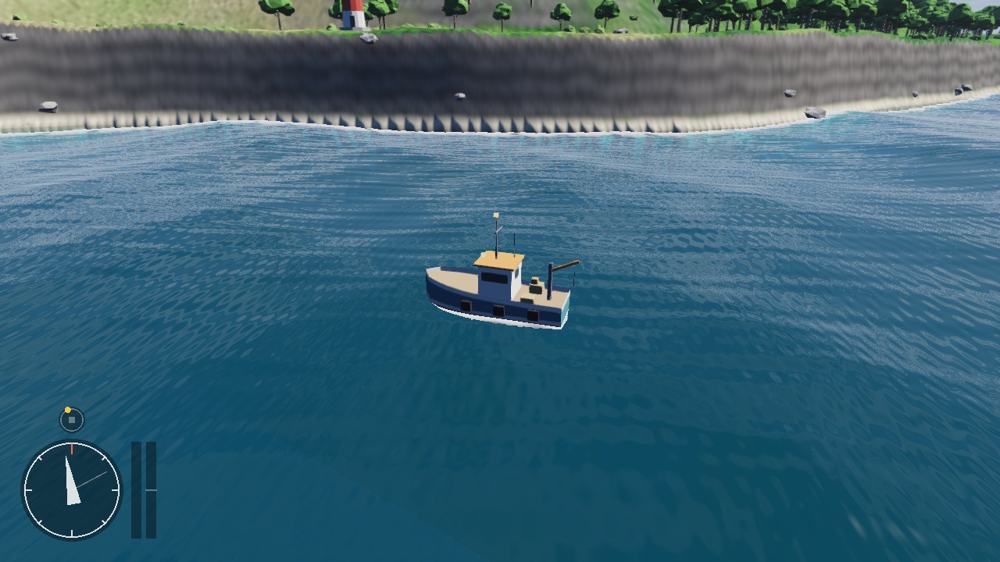
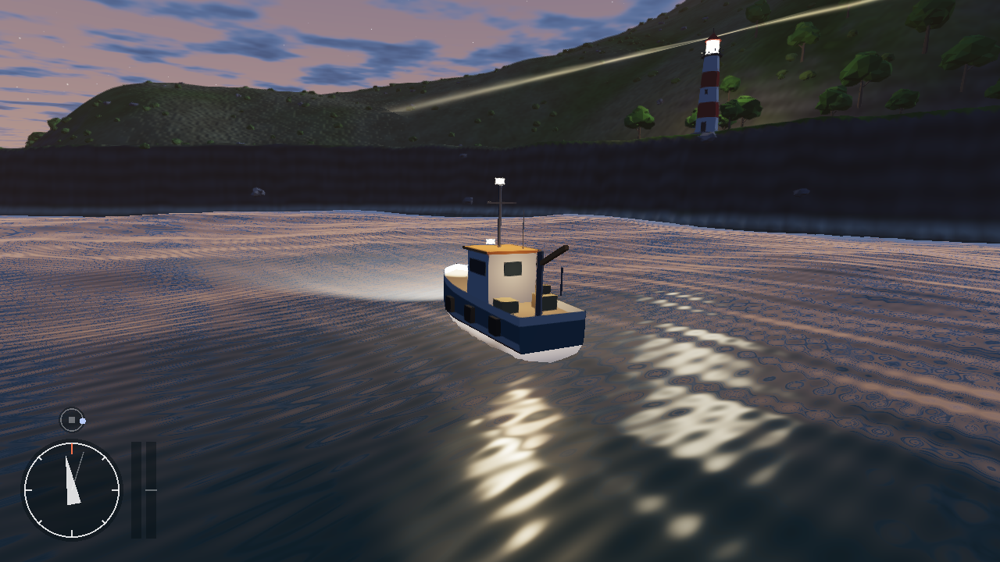
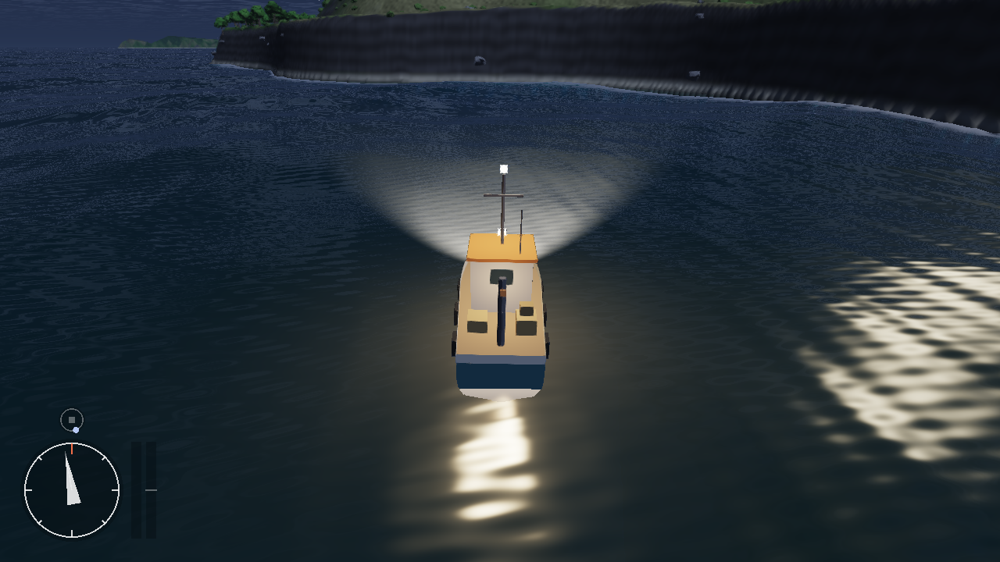
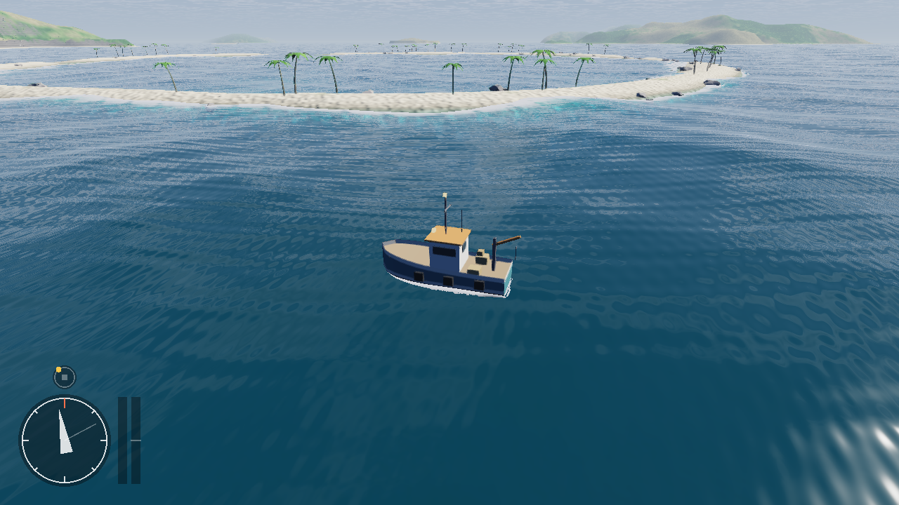
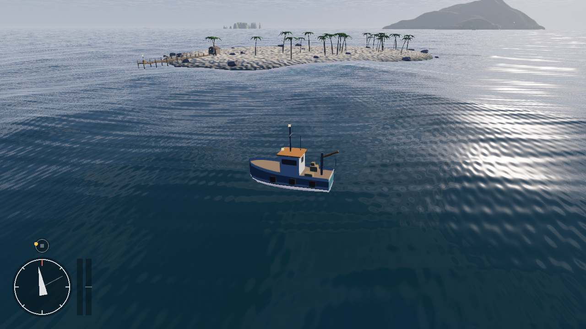

# SeaSail

An endless ocean full of procedurally generated islands that you explore in a small fishing boat. It's written from scratch in **C++17 and OpenGL 3.3**, with no engine, no math library and no art assets: the terrain, waves, trees, buildings, boat and camera are all code. The handling and camera take their cue from *Dredge*.



| Dusk: the lighthouse beam sweeps | Night: the boat's lamps on the water |
|---|---|
|  |  |

| Atoll | Cay with a jetty and fishing hut |
|---|---|
|  |  |

---

## Build and run

You need CMake 3.16+, a C++17 compiler and **Git**. The first configure downloads GLFW, the window library. The OpenGL loader (glad) is already in `external/`.

**Windows, Visual Studio 2022 (easiest)**
1. **File → Open → Folder…** and choose this folder.
2. Wait for "CMake generation finished", then switch the configuration from **x64-Debug** to **x64-Release**. The Debug build generates terrain much more slowly.
3. Pick **SeaSail.exe** as the startup item and press **F5**.

**Windows, command line** (Developer PowerShell for VS)
```bat
cmake -S . -B build
cmake --build build --config Release
build\Release\SeaSail.exe
```

**Linux / macOS**
```bash
cmake -S . -B build -DCMAKE_BUILD_TYPE=Release
cmake --build build -j
./build/SeaSail
```

## Controls

| Key | Action | Key | Action |
|---|---|---|---|
| **W / S** | throttle ahead / astern | **A / D** | steer |
| **Shift** | boost | **Mouse** | orbit the camera |
| **Wheel** | zoom | **Tab** | release / capture the mouse |
| **[ / ]** | time of day back / forward | **T** | pause / resume the clock |
| **L** | boat lights on / off | **V** | free camera (WASD, Space/C) |
| **Backspace** | respawn next to an island | **N** | new world (new seed) |
| **M** | minimap zoom (400 m / 1 km / 2.5 km) | **H** | hide HUD |
| **F** | wireframe | **R** | hot-reload shaders |
| **P** | screenshot (.bmp) | **Esc** | quit |
| **`** or **F1** | developer console | | |

**HUD**:
- **Minimap**, bottom left: a sea chart centred on your boat (the yellow arrow), with north up.
  - Water is shaded by depth, with a pale line where it shelves to 10 m. Islands are shown with hill shading and dark coastlines.
  - Lighthouses are red-and-white dots and jetties are brown marks. The faint line is where the camera is looking.
  - The dots underneath show the zoom level.
- **Clock**: the small dial is the time of day. The dot is the sun by day and the moon by night, with midnight at the bottom.
- **Bars**: the blue bar is speed, and turns amber while boosting. The last bar is the engine telegraph: up is ahead, down is astern.

A full day lasts 16 real minutes. The lamps come on at dusk.

### Developer console
Press **`** (the key left of 1) or **F1** to open it. The game ignores the keyboard while you type, and **Esc** or **`** closes the console again. Type `help` for the list, `help <command>` for details, or `help all` for every command on one line each.

| Group | Commands |
| --- | --- |
| Boat | `tp <x> <z>`, `tp island [mountain\|atoll\|stacks\|cay]`, `pos`, `heading <deg>`, `speed [m/s]`, `ghost [on\|off]`, `tune [name value\|reset]`, `respawn` |
| World | `seed [n]`, `newworld`, `viewdist [chunks]`, `waves [0..3]`, `fog [density\|reset]` |
| Time | `time [hh[:mm]]`, `pause [on\|off]`, `daylength [minutes]` |
| Camera | `view chase\|side\|high\|low\|cove`, `freecam [on\|off]`, `fov [deg]`, `zoom [m]` |
| Display | `hud`, `wireframe`, `lights`, `minimap [400\|1000\|2500]`, `reload`, `screenshot [file]`, `stats` |
| General | `help`, `clear`, `echo`, `exec <file>`, `quit` |

- **Shortcuts**:
  - Typing a command without its value shows the current setting (`time`, `speed`, `fog`).
  - On/off commands toggle when given no argument.
  - `tp ~200 ~` moves 200 m east of where you are.
- **Several at once**: separate commands with `;`, e.g. `time 19; waves 2; view high`.
- **Keys**:
  - **Tab** completes command names and options. A hint box under the input shows matching commands and their usage.
  - **Up / Down**: history.
  - **PgUp / PgDn** or the mouse wheel: scroll back.
  - **Ctrl+Backspace**: delete a word.
  - **Ctrl+V**: paste.
  - **Ctrl+L**: clear.
- **Testing handling**: `tune` lists the boat's handling values next to their defaults. Change them while you sail, e.g. `tune turn 1.4`, then use `tune reset` to undo.
- **Scripts**:
  - `exec file.cfg` runs a file of commands. Lines starting with `#` or `//` are comments.
  - If an `autoexec.cfg` is in the folder you run the game from, it runs at start-up.

### Command line
```
SeaSail --seed 7                          # a different world
SeaSail --island atoll                    # start next to an atoll (mountain | atoll | stacks | cay)
SeaSail --hour 21.5                       # start at night
SeaSail --radius 48                       # see further (in 128 m chunks; default 36 = 4.6 km)
SeaSail --view high --simulate 20 --steer 0.3 --shot test.bmp
                                          # drive for 20 s on autopilot, render one frame, exit
SeaSail --cmd "tp island atoll; time 19"  # run console commands at start (repeatable)
SeaSail --exec test.cfg                   # run a file of console commands at start
SeaSail --console                         # start with the console open (also shows in --shot)
```

---

## How it works

### Islands from a pure function (`src/world/IslandGenerator.cpp`)
Height is a pure function of world `(x, z)` in double precision. Nothing is stored, so the world is endless and costs no memory, and any piece of it can be built on any thread.
- **Placement**: the sea is divided into 1.5 km cells. A hash of the cell coordinates and the seed decides whether a cell has an island, and if so, its type, position and size. Centres stay away from cell borders, so a point only needs to check 9 cells.
- **Four island types**:
  - **Mountain islands**: hills from fbm, ridges from ridged multifractal noise, and beaches or **sea cliffs**. A cliff line wanders along the coast, and inland hills take over once they rise above the cliff top.
  - **Atolls**: a ring of sand around a shallow lagoon, broken by channels.
  - **Sea stacks**: steep rock pillars on a shallow shelf.
  - **Cays**: small, flat, sandy islets.
- **Coastlines**: a domain warp bends each island's circular outline into bays and headlands.
- **Beaches**: `h − 0.6·b·tanh(h/b)` squashes heights near sea level, so beaches come out wide and flat.

### Trees, rocks and gulls (`Props.cpp`, `PropRenderer.cpp`)
- **Five kinds of plants and rocks**, modelled in code: curved palms with drooping fronds and coconuts, broadleaf trees, pines, bushes and lumpy rocks.
- **Placement**: one candidate spot per 4 m world cell. A hash of the cell decides its jitter, size, rotation and tint, so every tree is always in the same place. Rules on height, slope and moisture then decide what grows there:
  - palms on the coast
  - forest where it's wet, turning to pine higher up
  - scrub on drier ground
  - boulders along the waterline
  - bare cliffs
- **Grounding**: props are placed on the exact triangles of the chunk mesh (same diagonal split as the renderer), so nothing floats or sinks.
- **Built on worker threads** along with each chunk's mesh, for chunks within ~1.5 km.
- **Drawing**: **instanced**, with one draw call per kind of prop however many are visible, and a per-frame instance buffer (orphaned, so the GPU never stalls).
  - Trees sway in the wind in the vertex shader. Higher parts move more, so trunks stay planted.
  - At the edge of the range, props dissolve with a screen-space dither instead of popping.
- **Gulls** wheel over the islands in flocks, each on its own circle and height, beating their wings in bursts and then gliding.

### Lighthouses and jetties (`Landmarks.cpp`, `LandmarkModels.cpp`)
- **Lighthouses** go on the headlands of bigger islands. The generator walks out from the island's centre to find the coast, then steps back inland.
- **Jetties with a fishing hut** go on sandy coasts. The generator tries a few directions for a gentle beach that reaches deep enough water 30 m out.
- Both are derived from the seed and cached per island, so they're always in the same place.
- At night each lighthouse **sweeps two beams**. They're drawn additively after the sea, and tested against the scene's distance buffer so islands still hide them.

### Day and night (`Environment.cpp`, `shaders/common.glsl`)
- The sun follows a proper arc: it rises in the east, stands high in the south at noon and sets in the west. The moon is roughly opposite.
- Sky colours blend between day, sunset and night palettes. Stars twinkle, and the moon has darker "seas".
- **Clouds**: a layer of clouds 1.2 km up, made from four octaves of value noise. They drift with the wind, catch a silver lining toward the sun, and are reflected in the water.
- At night exposure rises, as your eyes would adjust, and lamps come on:
  - the boat's masthead and deck lamps, plus a **searchlight cone** you can see on the water
  - lighthouse lamps and the lanterns on the jetties and huts

  All surfaces share one `surfaceLight()` function (sun + moon + sky + point lights + spotlight). The water adds glittering reflections of every lamp.

### Minimap (`Minimap.cpp`, `shaders/minimap.*`)
- The chart is a 192×192 texture painted on the CPU straight from the island generator, the same function the 3D terrain uses.
- Painting takes about 0.1 s, so it runs on a background thread (`std::async`). The old chart keeps being drawn, offset to the boat's position, until the new one is ready, so it never stalls a frame.
- It's repainted when the boat nears the edge of the painted area or the zoom changes.
- A shader cuts it into a circle, and the HUD draws the rim, ticks, icons and boat arrow on top.

### Console (`src/core/Console.cpp`, `src/render/ConsoleView.cpp`, `TextRenderer.cpp`)
- `Console` is plain C++ with no OpenGL or GLFW in it. It holds:
  - a table of commands (name, usage, help, a `std::function`, and Tab options)
  - a tokenizer that handles `;` and `"quoted strings"`
  - the scroll-back log, history and completion
- `main.cpp` registers the game's commands and feeds the console GLFW key and character events.
- Text uses a public-domain 8×8 bitmap font (`Font8x8.h`), unpacked at start-up into a 128×48 texture atlas. Each character is one textured quad, and the whole console is two draw calls: panel shapes, then text. The scale is a whole number, so the pixels stay sharp.
- Screenshots (`P` or `screenshot`) are saved after the scene and HUD are drawn but before the console, so it never ends up in the picture.

### Anti-aliasing
The off-screen scene gets **FXAA** in the composite pass. For each pixel it finds the local edge direction from the brightness of the four diagonal neighbours, then blurs only along that edge.

### Streaming, LOD and threads (`TerrainStreamer.cpp`)
- 128 m chunks are streamed in a 4.6 km circle around the camera. Detail depends on distance:
  - **1 m** grid cells right around the boat
  - 2, 4, 8 and 16 m in the rings beyond
  - 32 m out at the fog
- Worker threads build the meshes: height samples, plus normals from central differences using a one-sample border, so lighting is seamless across chunks. The main thread uploads finished meshes within a **3 ms per frame budget**, so streaming never stutters.
- Queued work is re-prioritised whenever you move: holes are filled first, then the nearest chunks.
- **Skirts** hide cracks between chunks at different detail levels.
- Deep-sea chunks get no mesh at all, and the rest are frustum-culled.

### Floating origin
GPU floats jitter a few km from (0, 0). Everything is therefore drawn relative to an origin stored as a `double`, which jumps in 1 km steps to stay near the boat. Positions are converted in double precision just before drawing, so the jump is invisible. Wave phases and detail noise are also computed so they line up across the jumps (see `Ocean::setUniforms` and `uOriginMod` in `shaders/common.glsl`).

### The ocean (`Ocean.cpp`, `shaders/water.*`)
- **Mesh**: a ring mesh follows the camera. Rings are 25 cm apart near you and grow to 20 km out.
- **Waves**: six **Gerstner waves** move the vertices, travelling at deep-water speed `ω = √(g·k)`. Four extra ripples only bend the lighting.
- **Exact CPU copy**: the boat floats on exactly the surface you see. The CPU runs the same waves. Gerstner waves also shift water sideways, so `Ocean::sample` first solves (by fixed-point iteration) for which undisplaced point ends up under the boat.
- **Looking through the water**:
  - Sky, terrain and boat are first rendered into an HDR target that also stores each pixel's distance from the camera.
  - The water shader uses those distances to work out how much water light crossed, and applies absorption with red absorbed first. That's why shallow water over sand is turquoise and deep water is dark blue.
  - **Foam** appears automatically wherever the water is shallow: along every coastline and around the hull.
  - Also: fake refraction, Fresnel sky reflection and sun glints.
- **Wake**: the last 12 seconds of the boat's track is passed to the shader. It draws a churned centre and two edges that spread apart, making a V.
- **Caustics** flicker on the shallow sea floor, and light dims with depth.

### The boat (`src/game/`)
- **Model** (`BoatModel.cpp`): a fishing boat built from code.
  - The hull is lofted from 15 cross-sections, with sheer, keel rocker and a flat transom.
  - Wheelhouse with windows, rust-orange roof, mast with lamps, crane, crates, and old tyres as fenders.
  - Flat-shaded, in a low-poly style.
- **Handling** (`Boat.cpp`), *Dredge*-style tank controls:
  - The throttle spools up and down, and speed carries momentum (linear and quadratic drag, with a top speed of ~16 knots, more with boost).
  - Steering needs water flowing past the rudder, but works a little even at rest.
  - The keel kills sideways drift gradually, so the boat slides a bit in fast turns.
  - The hull **rides the waves**: it samples the surface at the bow, stern and both sides, follows their average height through a spring, and tilts to their slope. On top of that, it **leans into turns** and **lifts its bow** under power.
  - **Running aground**: probes around the hull hit the sea floor. The boat is pushed toward deeper water (down the terrain gradient), loses speed scraping, and bounces off a little.
- **Camera** (`ChaseCamera.cpp`): a high three-quarter view.
  - It orbits freely with the mouse and doesn't swing round when the boat turns, as in *Dredge*. The wheel zooms.
  - It follows the boat with exponential smoothing and never dips below the waves or the ground.

### Rendering order (each frame)
1. **HDR scene target**, where each pass writes colour plus camera distance:
   - sky (with stars, moon and clouds)
   - terrain chunks
   - instanced trees, rocks and gulls
   - lighthouses and jetties
   - the boat
2. **Screen**: the scene is tone-mapped (ACES) and anti-aliased (FXAA) onto the screen.
3. **Sea**: drawn on top, reading the scene's colour and distance to see through itself.
4. **Lighthouse beams**: added on top.
5. **HUD**.
6. **Console**, if it's open (screenshots are taken just before this).

---

## Code layout
```
src/main.cpp              window, input, game loop, render passes, HUD, console commands, test mode
src/core/                 SeaMath.h (Vec3, Mat4, Quat), Camera, Noise, Shader (#include, hot reload), Screenshot,
                          Console (commands, history, completion)
src/world/                IslandGenerator, TerrainStreamer, Ocean, Props (placement), Landmarks
src/game/                 Boat (handling), BoatModel (procedural mesh), ChaseCamera, Environment (time of day)
src/render/               Mesh (+builder), PropRenderer (instancing + plant models), LandmarkModels,
                          SceneTarget (HDR + distance), Frustum, Hud, Minimap, TextRenderer (+ Font8x8.h),
                          ConsoleView
shaders/                  sky, terrain, props, object, water, beam, composite (FXAA), hud, minimap, text
                          + shared common.glsl
external/glad/            OpenGL 3.3 core loader
```

## Ideas for next steps
- Gameplay: dock at the jetties, fishing spots, a full-screen map that fills in as you explore.
- Weather: wind that changes the waves, fog banks rolling in at night, rain.
- Shadows (a shadow map from the sun) and grass close to the camera.
- Spray particles at the bow, and sound.

## Author
Nimeshkumar (E) Chaudhari
